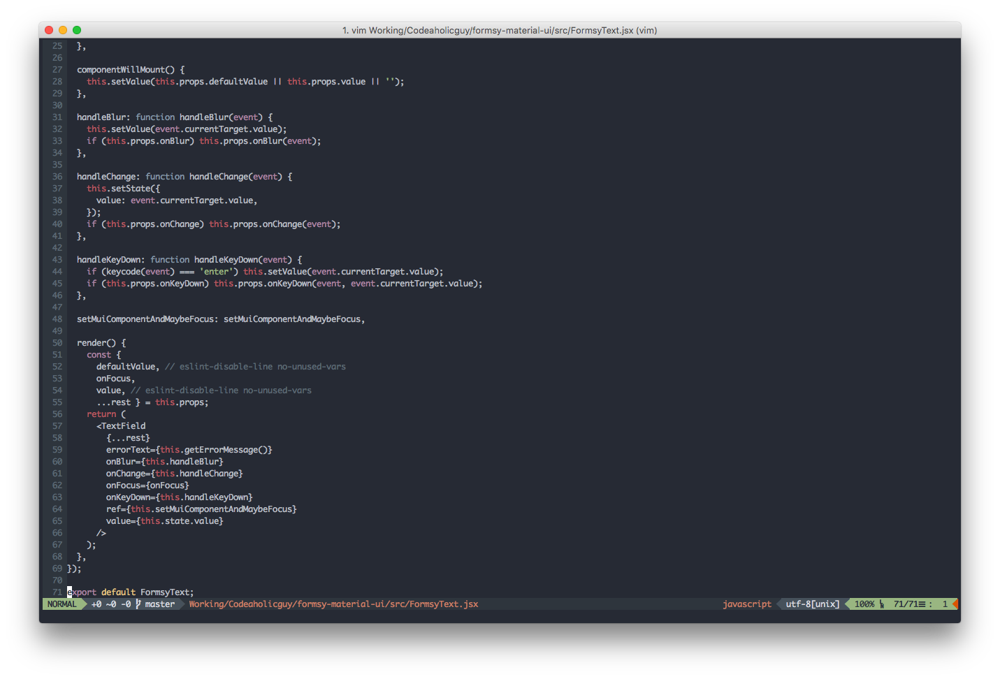

# dotfiles
A set of `vim`, `zsh`, and `tmux` configuration files for JavaScript Developer who likes to use Vim/NeoVim on macOS or Ubuntu.

Install
-------

Clone onto your machine:

    git clone git://github.com/codeaholicguy/dotfiles.git

Simply run file (maybe you must run `chmod +x ./install.sh` before run that file):

    ./install.sh --macos

On Ubuntu, install dependencies and link dotfiles:

    ./install.sh --linux

Or run those steps separately:

    ./install.sh --deps
    ./install.sh --dotfiles

Theme setup is opt-in:

    ./install.sh --theme

To install vim/neovim plugins:

    ./install.sh --post-install

If you prefer to run plugin commands manually, in `vim/neovim` run:

    :PlugClean
    :PlugInstall

If you want to get newest version of `vim/neovim` plugin, in `vim/neovim` simply run:

    :PlugUpdate

Credit
-------

Thanks to:

https://github.com/dracula/dracula-theme/

